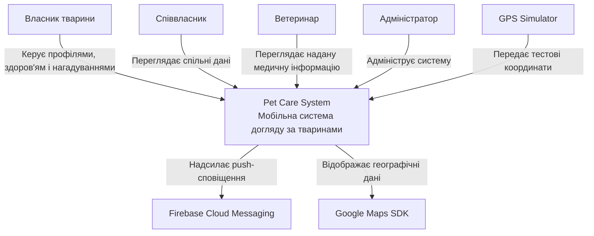
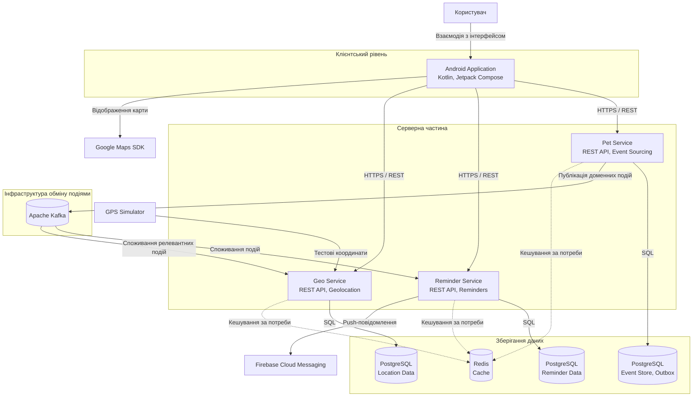
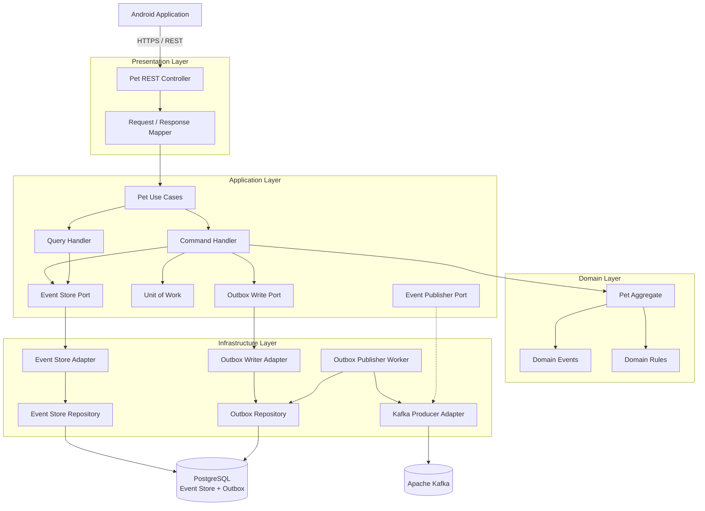

# 2. Проєктування архітектури системи

## 2.1. Загальна архітектура та контекст системи (C4 Level 1)

На контекстному рівні Pet Care System розглядається як єдина програмна система, що взаємодіє з власниками домашніх тварин, співвласниками, ветеринарами та зовнішніми сервісами.

Основним інтерфейсом користувача є Android-застосунок. Серверна частина забезпечує керування профілями тварин, медичною історією, нагадуваннями та геолокаційними даними.

### Діаграма 1. System Context

### Опис взаємодій

- Власник створює профілі тварин, додає медичні записи та налаштовує нагадування.
- Співвласник отримує доступ до спільної інформації відповідно до наданих прав.
- Ветеринар переглядає інформацію, до якої йому надано доступ.
- Адміністратор виконує адміністративні операції.
- Firebase Cloud Messaging використовується для доставки push-сповіщень.
- Google Maps SDK використовується для відображення географічних координат.
- GPS Simulator виступає джерелом тестових координат на початковому етапі розроблення.

## 2.2. Контейнери системи (C4 Level 2)

На контейнерному рівні система поділяється на Android-клієнт, три серверні мікросервіси, брокер повідомлень та сховища даних.

### Діаграма 2. Container Diagram

### Опис контейнерів

**Android Application**

Мобільний клієнт, розроблений на Kotlin із використанням Jetpack Compose. Забезпечує взаємодію користувача із системою та надсилає запити до серверних API.

**Pet Service**

Відповідає за профілі домашніх тварин та їхню медичну історію. Використовує Event Sourcing: зміни предметної області зберігаються як послідовність доменних подій. Для надійної публікації подій використовується Transactional Outbox.

**Reminder Service**

Відповідає за створення, редагування, виконання та планування нагадувань. Отримує релевантні події через Kafka та використовує PostgreSQL для зберігання власних даних.

**Geo Service**

Відповідає за отримання, збереження та надання географічних координат. На початковому етапі використовує GPS Simulator як джерело тестових координат.

**Apache Kafka**

Забезпечує асинхронний обмін подіями між серверними сервісами. Дає змогу незалежно підключати споживачів та повторно читати збережені повідомлення в межах політики зберігання.

**PostgreSQL**

Використовується як основне реляційне сховище. Кожен сервіс володіє власними даними. У Pet Service зберігаються Event Store та Outbox.

**Redis**

Допоміжне сховище для кешування даних. Не є основним джерелом достовірного стану системи.

## 2.3. Компонентна архітектура Pet Service (C4 Level 3)

Для деталізації обрано Pet Service, оскільки саме він реалізує Event Sourcing та механізм Transactional Outbox. Його внутрішня структура демонструє розділення бізнес-логіки, прикладних сценаріїв і деталей інфраструктури.

### Діаграма 3. Component Diagram — Pet Service

### 2.3.1. Призначення компонентів

| Компонент | Відповідальність |
|---|---|
| Pet REST Controller | Приймає HTTP-запити та передає їх у прикладний рівень |
| Request / Response Mapper | Перетворює DTO запитів і відповідей |
| Pet Use Cases | Координує прикладні сценарії роботи з тваринами |
| Command Handler | Обробляє команди на зміну стану |
| Query Handler | Забезпечує сценарії читання даних |
| Pet Aggregate | Інкапсулює стан та бізнес-правила агрегату тварини |
| Domain Events | Представляє факти змін у предметній області |
| Domain Rules | Містить правила та інваріанти предметної області |
| Event Store Port | Абстракція доступу до сховища подій |
| Outbox Write Port | Абстракція запису повідомлень до Outbox |
| Unit of Work | Координує транзакційне збереження змін |
| Event Store Adapter | Реалізує доступ до Event Store |
| Outbox Writer Adapter | Реалізує запис повідомлень до Outbox |
| Event Store Repository | Виконує операції з таблицями Event Store |
| Outbox Repository | Виконує операції з таблицею Outbox |
| Outbox Publisher Worker | Фоново знаходить непубліковані повідомлення та ініціює їхню публікацію |
| Kafka Producer Adapter | Відповідає за технічну взаємодію з Apache Kafka |

### 2.3.2. Сценарій запису доменної події

1. Користувач надсилає запит через Android Application.
2. Pet REST Controller приймає запит та передає його до відповідного Use Case.
3. Command Handler завантажує поточний стан агрегату шляхом відтворення його подій.
4. Pet Aggregate перевіряє бізнес-правила та формує нову доменну подію.
5. Unit of Work координує збереження нової події в Event Store та відповідного запису в Outbox.
6. Event Store Adapter і Outbox Writer Adapter виконують операції з PostgreSQL у межах однієї транзакції.
7. Після успішного commit Outbox Publisher Worker знаходить запис, який очікує публікації.
8. Kafka Producer Adapter надсилає повідомлення до відповідного Kafka topic.
9. Після підтвердження публікації запис Outbox позначається як оброблений.

Таким чином, зміна в Event Store та створення запису Outbox є атомарними в межах однієї транзакції PostgreSQL. Публікація в Kafka виконується окремим фоновим процесом.

### 2.3.3. Надійність обміну подіями

У системі використовується модель доставки at-least-once. Це означає, що повідомлення може бути доставлене повторно. Тому споживачі повинні перевіряти ідентифікатори подій та забезпечувати ідемпотентну обробку.

Для подій, пов'язаних з однією твариною, як Kafka message key використовується `pet_id`. Це дозволяє зберігати порядок повідомлень у межах однієї partition. Глобальний порядок між усіма повідомленнями системи не гарантується.

## 2.4. Трасування вимог в архітектуру

Трасування встановлює зв'язок між вимогами з [SRS](srs.md), контейнерами та компонентами C4, а також архітектурним рішенням [ADR-001](adr/0001-choice-of-technology.md).

| Вимоги SRS | Архітектурний елемент | Реалізація / обґрунтування |
|---|---|---|
| SRS-FUN-01 – SRS-FUN-05 | Android Application, Pet Service, Reminder Service, Geo Service | Керування користувачами та доступом |
| SRS-FUN-06 – SRS-FUN-14 | Pet Service, Pet Aggregate, Pet REST Controller | Керування профілями тварин |
| SRS-FUN-15 – SRS-FUN-23 | Pet Service, Event Store, Pet Aggregate, Domain Events | Медична історія та збереження історії змін |
| SRS-FUN-24 – SRS-FUN-32 | Reminder Service, Apache Kafka, Firebase Cloud Messaging | Створення нагадувань та сповіщення |
| SRS-FUN-33 – SRS-FUN-37 | Geo Service, GPS Simulator, PostgreSQL, Google Maps SDK | Отримання та відображення координат |
| SRS-FUN-38 – SRS-FUN-43 | Pet Service, Outbox Publisher Worker, Apache Kafka, споживачі подій | Публікація та оброблення доменних подій; [ADR-001](adr/0001-choice-of-technology.md) |
| SRS-NFR-01 – SRS-NFR-03 | Серверні сервіси, REST API, Kafka | Продуктивність та незалежна обробка запитів і подій |
| SRS-NFR-04 – SRS-NFR-07 | PostgreSQL, Event Store, Transactional Outbox | Цілісність та надійність збереження і передавання подій |
| SRS-NFR-08 – SRS-NFR-11 | REST API та механізми автентифікації й авторизації | Захист даних і контроль доступу |
| SRS-NFR-12 – SRS-NFR-15 | Розділення сервісів, порти та адаптери Pet Service | Супроводжуваність та розширюваність |
| SRS-NFR-16 – SRS-NFR-18 | Android Application, Google Maps SDK | Платформна сумісність та зручність використання |

### 2.4.1. Зв'язок архітектури з ADR-001

Вибір Apache Kafka для асинхронної взаємодії між сервісами обґрунтовано в [ADR-001: Вибір брокера повідомлень](adr/0001-choice-of-technology.md).

Kafka використовується для передавання доменних подій від Pet Service до інших сервісів. Її модель збереження потоку подій, незалежні consumer groups та можливість повторного читання повідомлень відповідають обраному підходу Event Sourcing.

Transactional Outbox у Pet Service забезпечує узгодженість між збереженням доменної події в PostgreSQL та подальшою публікацією в Kafka.

### 2.4.2. Висновок

Спроєктована архітектура розділяє клієнтську частину, серверні сервіси та інфраструктуру обміну повідомленнями. Pet Service виділено як компонент із найбільш складною доменною логікою через використання Event Sourcing та Transactional Outbox.

Трасування пов'язує вимоги SRS із контейнерами та внутрішніми компонентами системи, а ADR-001 фіксує обґрунтування вибору брокера повідомлень. Документація підтримується у Markdown безпосередньо в Git-репозиторії відповідно до принципу Docs-as-Code.