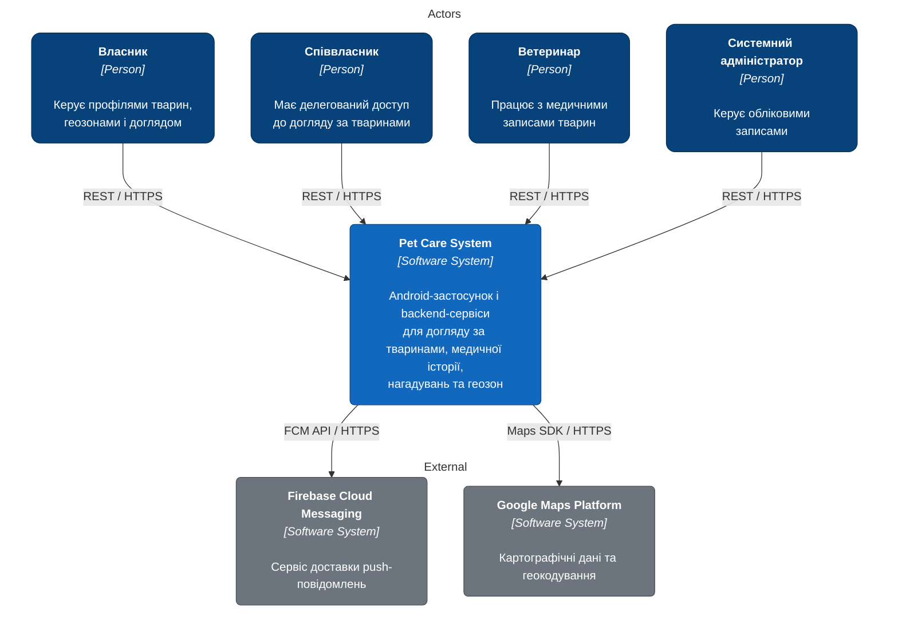
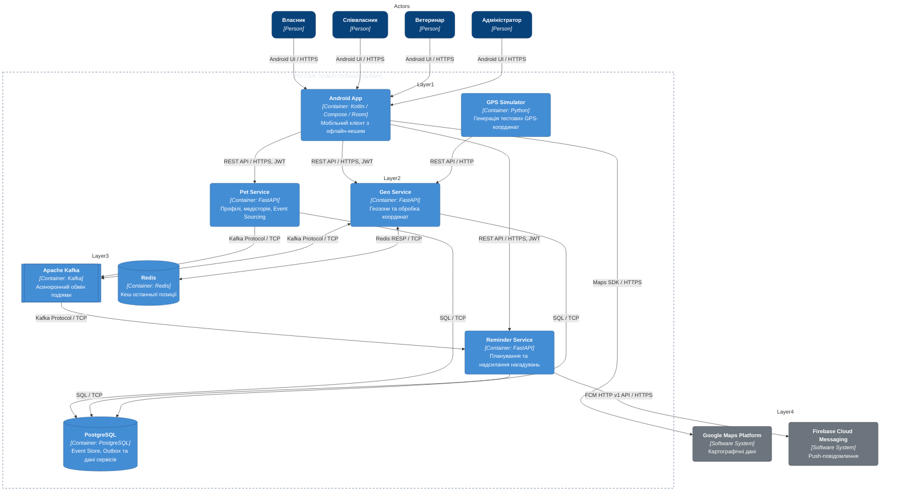
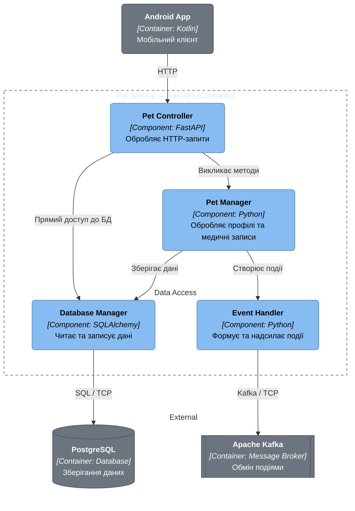
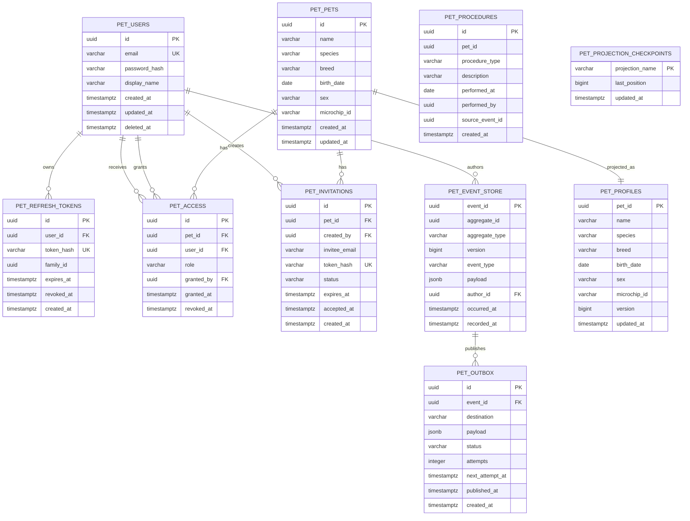
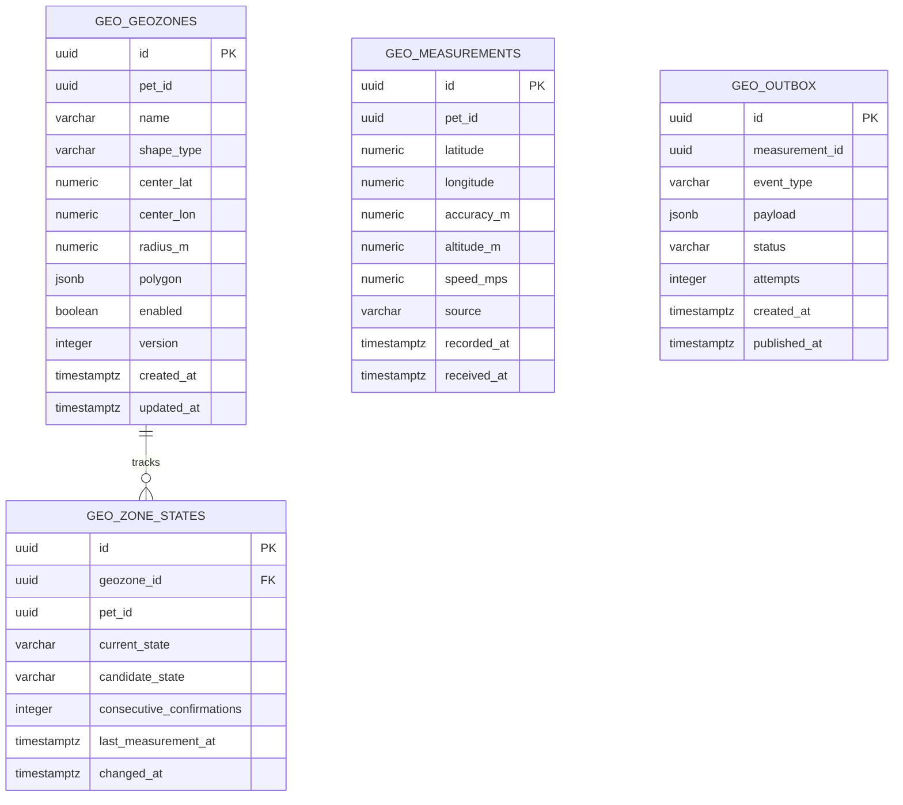
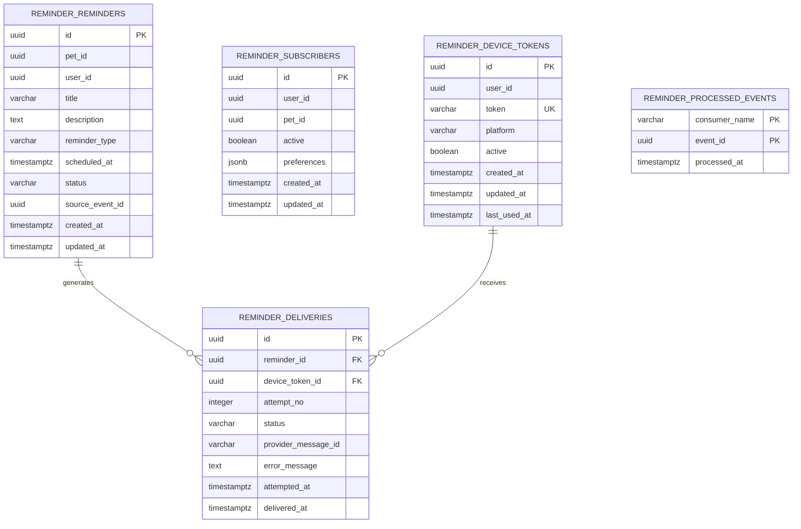
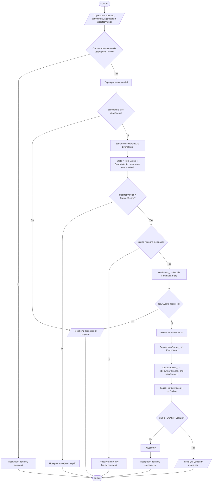
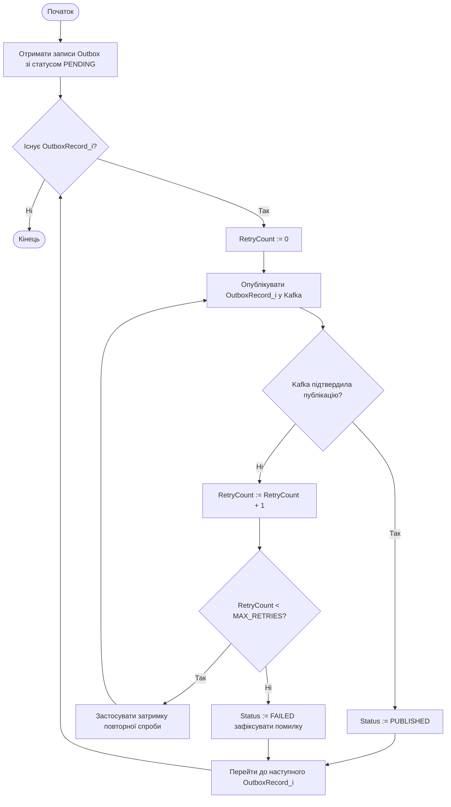
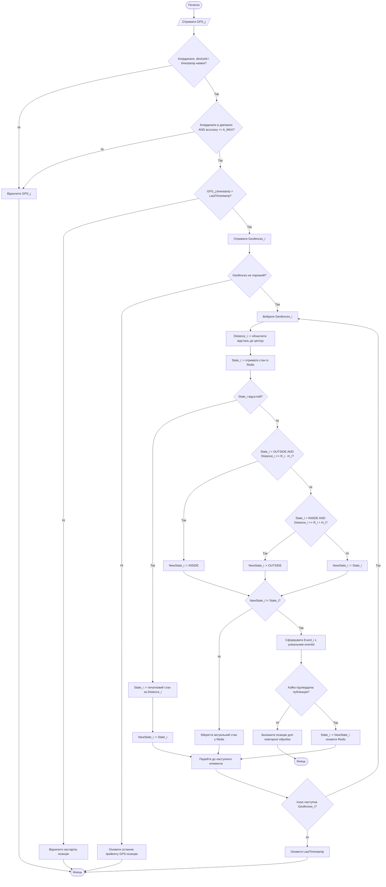
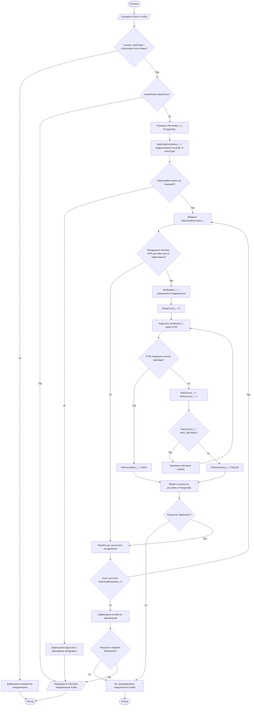

# 2. Проєктування архітектури системи

## 2.1. Загальна архітектура та контекст системи (C4 Level 1)

На контекстному рівні Pet Care System розглядається як єдина програмна система, що взаємодіє з власниками домашніх
тварин, співвласниками, ветеринарами та зовнішніми сервісами.

Основним інтерфейсом користувача є Android-застосунок. Серверна частина забезпечує керування профілями тварин, медичною
історією, нагадуваннями та геолокаційними даними.

### Діаграма 1. System Context

### Опис взаємодій

- Власник створює профілі тварин, додає медичні записи та налаштовує нагадування.
- Співвласник отримує доступ до спільної інформації відповідно до наданих прав.
- Ветеринар переглядає інформацію, до якої йому надано доступ.
- Адміністратор виконує адміністративні операції.
- Firebase Cloud Messaging використовується для доставки push-сповіщень.
- Google Maps SDK використовується для відображення географічних координат.
- GPS Simulator виступає джерелом тестових координат на початковому етапі розроблення.

## 2.2. Контейнери системи (C4 Level 2)

На контейнерному рівні система поділяється на Android-клієнт, три серверні мікросервіси, брокер повідомлень та сховища
даних.

### Діаграма 2. Container Diagram

### Опис контейнерів

**Android Application**

Мобільний клієнт, розроблений на Kotlin із використанням Jetpack Compose. Забезпечує взаємодію користувача із системою
та надсилає запити до серверних API.

**Pet Service**

Відповідає за профілі домашніх тварин та їхню медичну історію. Використовує Event Sourcing: зміни предметної області
зберігаються як послідовність доменних подій. Для надійної публікації подій використовується Transactional Outbox.

**Reminder Service**

Відповідає за створення, редагування, виконання та планування нагадувань. Отримує релевантні події через Kafka та
використовує PostgreSQL для зберігання власних даних.

**Geo Service**

Відповідає за отримання, збереження та надання географічних координат. На початковому етапі використовує GPS Simulator
як джерело тестових координат.

**Apache Kafka**

Забезпечує асинхронний обмін подіями між серверними сервісами. Дає змогу незалежно підключати споживачів та повторно
читати збережені повідомлення в межах політики зберігання.

**PostgreSQL**

Використовується як основне реляційне сховище. Кожен сервіс володіє власними даними. У Pet Service зберігаються Event
Store та Outbox.

**Redis**

Допоміжне сховище для кешування даних. Не є основним джерелом достовірного стану системи.

## 2.3. Компонентна архітектура Pet Service (C4 Level 3)

Для деталізації обрано Pet Service, оскільки саме він реалізує Event Sourcing та механізм Transactional Outbox. Його
внутрішня структура демонструє розділення бізнес-логіки, прикладних сценаріїв і деталей інфраструктури.

### Діаграма 3. Component Diagram — Pet Service

### 2.3.1. Призначення компонентів

| Компонент                 | Відповідальність                                                       |
|---------------------------|------------------------------------------------------------------------|
| Pet REST Controller       | Приймає HTTP-запити та передає їх у прикладний рівень                  |
| Request / Response Mapper | Перетворює DTO запитів і відповідей                                    |
| Pet Use Cases             | Координує прикладні сценарії роботи з тваринами                        |
| Command Handler           | Обробляє команди на зміну стану                                        |
| Query Handler             | Забезпечує сценарії читання даних                                      |
| Pet Aggregate             | Інкапсулює стан та бізнес-правила агрегату тварини                     |
| Domain Events             | Представляє факти змін у предметній області                            |
| Domain Rules              | Містить правила та інваріанти предметної області                       |
| Event Store Port          | Абстракція доступу до сховища подій                                    |
| Outbox Write Port         | Абстракція запису повідомлень до Outbox                                |
| Unit of Work              | Координує транзакційне збереження змін                                 |
| Event Store Adapter       | Реалізує доступ до Event Store                                         |
| Outbox Writer Adapter     | Реалізує запис повідомлень до Outbox                                   |
| Event Store Repository    | Виконує операції з таблицями Event Store                               |
| Outbox Repository         | Виконує операції з таблицею Outbox                                     |
| Outbox Publisher Worker   | Фоново знаходить непубліковані повідомлення та ініціює їхню публікацію |
| Kafka Producer Adapter    | Відповідає за технічну взаємодію з Apache Kafka                        |

### 2.3.2. Сценарій запису доменної події

1. Користувач надсилає запит через Android Application.
2. Pet REST Controller приймає запит та передає його до відповідного Use Case.
3. Command Handler завантажує поточний стан агрегату шляхом відтворення його подій.
4. Pet Aggregate перевіряє бізнес-правила та формує нову доменну подію.
5. Unit of Work координує збереження нової події в Event Store та відповідного запису в Outbox.
6. Event Store Adapter і Outbox Writer Adapter виконують операції з PostgreSQL у межах однієї транзакції.
7. Після успішного commit Outbox Publisher Worker знаходить запис, який очікує публікації.
8. Kafka Producer Adapter надсилає повідомлення до відповідного Kafka topic.
9. Після підтвердження публікації запис Outbox позначається як оброблений.

Таким чином, зміна в Event Store та створення запису Outbox є атомарними в межах однієї транзакції PostgreSQL.
Публікація в Kafka виконується окремим фоновим процесом.

### 2.3.3. Надійність обміну подіями

У системі використовується модель доставки at-least-once. Це означає, що повідомлення може бути доставлене повторно.
Тому споживачі повинні перевіряти ідентифікатори подій та забезпечувати ідемпотентну обробку.

Для подій, пов'язаних з однією твариною, як Kafka message key використовується `pet_id`. Це дозволяє зберігати порядок
повідомлень у межах однієї partition. Глобальний порядок між усіма повідомленнями системи не гарантується.

## 2.4. Трасування вимог в архітектуру

Трасування встановлює зв'язок між вимогами з [SRS](srs.md), контейнерами та компонентами C4, а також архітектурним
рішенням [ADR-001](adr/0001-choice-of-technology.md).

| Вимоги SRS              | Архітектурний елемент                                               | Реалізація / обґрунтування                                                           |
|-------------------------|---------------------------------------------------------------------|--------------------------------------------------------------------------------------|
| SRS-FUN-01 – SRS-FUN-05 | Android Application, Pet Service, Reminder Service, Geo Service     | Керування користувачами та доступом                                                  |
| SRS-FUN-06 – SRS-FUN-14 | Pet Service, Pet Aggregate, Pet REST Controller                     | Керування профілями тварин                                                           |
| SRS-FUN-15 – SRS-FUN-23 | Pet Service, Event Store, Pet Aggregate, Domain Events              | Медична історія та збереження історії змін                                           |
| SRS-FUN-24 – SRS-FUN-32 | Reminder Service, Apache Kafka, Firebase Cloud Messaging            | Створення нагадувань та сповіщення                                                   |
| SRS-FUN-33 – SRS-FUN-37 | Geo Service, GPS Simulator, PostgreSQL, Google Maps SDK             | Отримання та відображення координат                                                  |
| SRS-FUN-38 – SRS-FUN-43 | Pet Service, Outbox Publisher Worker, Apache Kafka, споживачі подій | Публікація та оброблення доменних подій; [ADR-001](adr/0001-choice-of-technology.md) |
| SRS-NFR-01 – SRS-NFR-03 | Серверні сервіси, REST API, Kafka                                   | Продуктивність та незалежна обробка запитів і подій                                  |
| SRS-NFR-04 – SRS-NFR-07 | PostgreSQL, Event Store, Transactional Outbox                       | Цілісність та надійність збереження і передавання подій                              |
| SRS-NFR-08 – SRS-NFR-11 | REST API та механізми автентифікації й авторизації                  | Захист даних і контроль доступу                                                      |
| SRS-NFR-12 – SRS-NFR-15 | Розділення сервісів, порти та адаптери Pet Service                  | Супроводжуваність та розширюваність                                                  |
| SRS-NFR-16 – SRS-NFR-18 | Android Application, Google Maps SDK                                | Платформна сумісність та зручність використання                                      |

### 2.4.1. Зв'язок архітектури з ADR-001

Вибір Apache Kafka для асинхронної взаємодії між сервісами обґрунтовано
в [ADR-001: Вибір брокера повідомлень](adr/0001-choice-of-technology.md).

Kafka використовується для передавання доменних подій від Pet Service до інших сервісів. Її модель збереження потоку
подій, незалежні consumer groups та можливість повторного читання повідомлень відповідають обраному підходу Event
Sourcing.

Transactional Outbox у Pet Service забезпечує узгодженість між збереженням доменної події в PostgreSQL та подальшою
публікацією в Kafka.

### 2.4.2.1. ER-діаграма схеми `pet`

Схема `pet` містить основні сутності системи та компоненти реалізації Event Sourcing. Діаграма відображає зв'язки між користувачами, домашніми тваринами, правами доступу, запрошеннями, журналом подій, проєкціями та таблицею Outbox.

### 2.4.2.2. ER-діаграма схеми `geo`

Схема `geo` призначена для зберігання геолокаційних даних і визначення стану перебування тварин у заданих геозонах. Основними сутностями є геозони, стани геозон, вимірювання координат і записи Outbox.

Для таблиці `geo_measurements` передбачається секціонування за полем `recorded_at`. З цієї причини первинний ключ у фізичній базі даних формується як складений ключ `(id, recorded_at)`. На ER-діаграмі тип ідентифікатора показано окремо для зручності читання, тому повне фізичне визначення ключа необхідно враховувати під час реалізації SQL-схеми.

Поле `pet_id` у таблицях `geozones`, `zone_states` і `geo_measurements` є логічним посиланням на тварину, зареєстровану в сервісі `pet`. Воно не реалізується як фізичний зовнішній ключ між схемами.

### 2.4.2.3. ER-діаграма схеми `reminder`

Схема `reminder` забезпечує створення, зберігання та доставку нагадувань користувачам. Вона містить інформацію про пристрої, підписки, заплановані нагадування та результати їх доставки.

Поля `user_id`, `pet_id` і `source_event_id` у схемі `reminder` використовуються як логічні посилання на дані інших сервісів. Це дає змогу сервісу нагадувань працювати незалежно від фізичної структури таблиць сервісу керування тваринами.

### 2.4.3. Висновок

Спроєктована архітектура розділяє клієнтську частину, серверні сервіси та інфраструктуру обміну повідомленнями. Pet
Service виділено як компонент із найбільш складною доменною логікою через використання Event Sourcing та Transactional
Outbox.

Трасування пов'язує вимоги SRS із контейнерами та внутрішніми компонентами системи, а ADR-001 фіксує обґрунтування
вибору брокера повідомлень. Документація підтримується у Markdown безпосередньо в Git-репозиторії відповідно до принципу
Docs-as-Code.

## 2.5. Специфікація міжсервісних контрактів (API Contracts)

## 2.5.1. Вибір технології та межі контракту

Для специфікації REST-інтерфейсу системи використовується стандарт **OpenAPI 3.0.3** у форматі YAML.

Контракт описує взаємодію між контейнерами **Frontend SPA** та **Backend API (API Gateway)**. Він визначає структуру HTTP-запитів і відповідей, правила валідації вхідних даних, механізм авторизації та формати повідомлень про помилки.

Для демонстрації контракту обрано сценарій керування домашніми тваринами. Він охоплює три основні операції:

- отримання списку домашніх тварин авторизованого користувача;
- створення нової домашньої тварини;
- отримання інформації про конкретну тварину за її ідентифікатором.

Авторизація здійснюється за допомогою JWT Bearer Token. Ідентифікатор користувача визначається сервером на основі токена, а не передається клієнтом у тілі запиту. Це запобігає можливості створення записів від імені іншого користувача шляхом підміни `user_id`.

Контракт описує зовнішній REST-інтерфейс Backend API. Внутрішня взаємодія Backend API з Pet Service не є частиною цього контракту та може реалізовуватися через окремі внутрішні інтерфейси.

## 2.5.2. Опис API-операцій

У межах контракту визначено три операції для роботи з ресурсом `Pet`.

| HTTP-метод | Endpoint        | Призначення                                                   |
|------------|-----------------|---------------------------------------------------------------|
| GET        | `/pets`         | Отримання списку тварин, доступних авторизованому користувачу |
| POST       | `/pets`         | Створення нової тварини                                       |
| GET        | `/pets/{petId}` | Отримання інформації про конкретну тварину                    |

### GET /pets — отримання списку тварин

Операція повертає список домашніх тварин, доступних авторизованому користувачу відповідно до його прав доступу.

Для керування обсягом відповіді передбачено два query-параметри:

- `limit` — максимальна кількість записів у відповіді. Допустимий діапазон — від 1 до 100, значення за замовчуванням — 20.
- `offset` — кількість записів, які потрібно пропустити. Значення за замовчуванням — 0.

Успішна відповідь має статус `200 OK` і містить масив тварин та метадані пагінації.

### POST /pets — створення тварини

Операція створює новий запис про домашню тварину.

Клієнт передає дані у форматі JSON відповідно до схеми `CreatePetRequest`. Ідентифікатор власника не передається в тілі запиту: Backend API визначає його на основі перевіреного JWT.

У разі успішного створення сервер повертає статус `201 Created`, URI створеного ресурсу в заголовку `Location` та представлення створеної тварини у форматі `PetResponse`.

### GET /pets/{petId} — отримання тварини за ідентифікатором

Операція повертає інформацію про конкретну тварину за її UUID.

Перед поверненням даних Backend API перевіряє наявність ресурсу та права доступу автентифікованого користувача. Якщо користувач не має необхідних прав, повертається `403 Forbidden`. Якщо ресурс не знайдено — `404 Not Found`.

Деталізовану специфікацію ендпоінтів у форматі OpenAPI 3.0 зафіксовано у файлі
[openapi.yaml](./api/openapi.yaml)

## 2.6. Моделювання логіки критичних вузлів системи

У цьому підрозділі наведено алгоритми трьох критичних вузлів системи Pet Care: обробки команд із використанням Event Sourcing, визначення перетину геозон та обробки подій для надсилання push-сповіщень. Алгоритми описують послідовність операцій, умови переходів, обробку помилок і граничних випадків.

Умовні позначення:

- `:=` — оператор присвоювання;
- `=` — оператор порівняння на рівність;
- `AND`, `OR`, `NOT` — логічні оператори;
- `Events[i]`, `Geofences[i]`, `Reminders[i]` — елементи відповідних колекцій;
- `MAX_RETRIES` — максимальна кількість спроб;
- `TIMEOUT` — граничний час очікування відповіді зовнішнього сервісу.

---

## 2.6.1. Алгоритм обробки команди в Pet Service з використанням Event Sourcing та Outbox

**Призначення.** Алгоритм забезпечує обробку команди зміни даних домашньої тварини. Поточний стан агрегату відновлюється на основі послідовності незмінних подій. Після перевірки команди нові події записуються до Event Store, а відповідні повідомлення — до Outbox у межах однієї транзакції PostgreSQL. Окремий процес публікує повідомлення Outbox у Kafka.

**Вхідні дані:**

- `Command` — команда зміни даних тварини;
- `aggregateId` — ідентифікатор агрегату Pet;
- `commandId` — унікальний ідентифікатор команди;
- `expectedVersion` — очікувана версія агрегату.

**Вихідні дані:**

- результат виконання команди;
- нові події `NewEvents[i]`;
- записи Outbox для подальшої публікації в Kafka.

**Основні змінні:**

- `Events[i]` — збережені події агрегату;
- `State` — відновлений стан агрегату;
- `CurrentVersion` — поточна версія агрегату;
- `NewEvents[i]` — події, сформовані в результаті команди;
- `OutboxRecord[i]` — записи для публікації в Kafka;
- `RetryCount` — кількість спроб публікації.

### Блок-схема алгоритму

### Блок-схема публікації Outbox

**Примітка щодо надійності.** Запис події та Outbox-запис виконуються атомарно в одній транзакції PostgreSQL. Публікація в Kafka відбувається окремо, тому можлива повторна доставка повідомлення у разі збою між публікацією та оновленням статусу Outbox. Споживачі подій мають враховувати можливість повторної доставки та забезпечувати ідемпотентну обробку за ідентифікатором події.

## 2.6.2. Алгоритм визначення входу та виходу з геозони в Geo Service

**Призначення.** Алгоритм визначає перетин геозони домашньою твариною на основі GPS-координат. Для зменшення хибних перемикань стану використовується гістерезис: умови входу та виходу мають різні порогові значення відстані.

**Вхідні дані:**

- `GPS[j]` — чергова GPS-позиція;
- `Geofences[i]` — множина налаштованих геозон;
- `R[i]` — радіус геозони;
- `H[i]` — ширина гістерезису;
- `A_MAX` — максимально допустима похибка GPS;
- `LastTimestamp` — час останньої прийнятої позиції.

**Вихідні дані:**

- оновлений стан перебування у геозоні;
- подія `GEOFENCE_ENTER` або `GEOFENCE_EXIT` у Kafka, якщо відбувся перехід.

**Основні змінні:**

- `Distance[i]` — відстань від GPS-позиції до центру геозони;
- `State[i]` — поточний стан геозони: `INSIDE` або `OUTSIDE`;
- `NewState[i]` — обчислений стан;
- `Event[i]` — сформована подія переходу.

### Блок-схема алгоритму

**Примітка щодо реалізації.** Для обчислення `Distance[i]` може використовуватися формула гаверсинусів. Параметри `R[i]`, `H[i]` та `A_MAX` мають зберігатися в конфігурації геозони або сервісу. Публікація в Kafka та оновлення Redis не є однією атомарною транзакцією. Тому повторна обробка може породити повторну доставку події, а споживачі повинні підтримувати ідемпотентність за `eventId`.

## 2.6.3. Алгоритм обробки події та надсилання push-сповіщення в Reminder Service

**Призначення.** Алгоритм забезпечує обробку повідомлення, отриманого з Kafka, пошук відповідних активних нагадувань та надсилання push-сповіщення користувачу через Firebase Cloud Messaging (FCM).

**Вхідні дані:**

- `Event` — повідомлення з Kafka;
- `eventId` — унікальний ідентифікатор події;
- `eventType` — тип події;
- `petId` — ідентифікатор тварини;
- `occurredAt` — час виникнення події;
- `Reminders[i]` — набір нагадувань, пов'язаних із твариною та типом події.

**Вихідні дані:**

- результат обробки події;
- статус надсилання повідомлення;
- запис про успішну або невдалу доставку.

**Основні змінні:**

- `ProcessedEvent` — ознака попередньої обробки події;
- `MatchingReminders[i]` — нагадування, що відповідають події;
- `Notification[i]` — сформоване push-сповіщення;
- `RetryCount[i]` — кількість спроб надсилання;
- `MAX_RETRIES` — максимальна кількість спроб;
- `FCMResponse` — результат відповіді FCM.

### Блок-схема алгоритму

**Примітка щодо доставки.** Kafka та FCM не утворюють спільної транзакції. Тому алгоритм не гарантує абсолютну доставку рівно один раз. Він забезпечує контроль повторної обробки на рівні `eventId` і збережених статусів. У разі аварії між прийняттям повідомлення FCM та фіксацією статусу в PostgreSQL можливе повторне надсилання. Цей ризик потрібно враховувати під час реалізації механізму доставки.

## 2.7. Інтеграційний аудит та верифікація цілісності доменів

## Офіційний технічний висновок (Production Readiness Report)

За результатами проведеного архітектурного інтеграційного аудиту встановлено, що модель даних PostgreSQL 16, зовнішній REST API-контракт OpenAPI 3.0.3 та алгоритми Pet Service, Geo Service і Reminder Service можуть функціонувати в межах єдиної узгодженої архітектури системи Pet Care.

Перевірка підтвердила:

1. **Узгодженість структури даних та API.** Поля REST-контракту мають відповідники в моделі даних. Типи ідентифікаторів, правила доступу та валідації визначені без суперечностей.
2. **Узгодженість Pet Service.** Механізми Event Sourcing, контролю версій агрегатів, ідемпотентності команд та Outbox узгоджені з призначенням таблиць домену `pet`.
3. **Узгодженість Geo Service.** Модель даних підтримує збереження геозон, вимірювань, поточних станів і результатів алгоритму визначення переходів. Конфігураційні параметри та повторна публікація подій визначені на архітектурному рівні.
4. **Узгодженість Reminder Service.** Модель підтримує облік нагадувань, пристроїв, доставок та оброблених подій. Передбачено механізми ідемпотентності логічних операцій та контролю повторної обробки.
5. **Узгодженість міжсервісної взаємодії.** Відповідальність REST API, Kafka та FCM розмежована. Логічні посилання між доменами не порушують принцип незалежності сервісів.

Зауваження, виявлені під час первинного аудиту, опрацьовані шляхом уточнення ролей сутностей, обмежень цілісності, правил ідемпотентності та форматів міжсервісної взаємодії. За умови відображення зазначених рішень у фінальних специфікаціях моделі даних та алгоритмів, **архітектурних конфліктів між СУБД, REST API-контрактом і логікою алгоритмів не виявлено**.

**Підсумковий статус: архітектурний інтеграційний аудит пройдено. Проєктна документація узгоджена на рівні моделей даних, API та алгоритмів.**